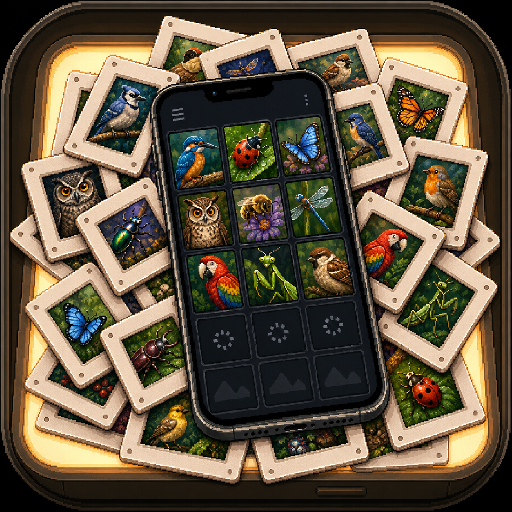

<p align="center">
  
</p>

# k1gal

Android gallery for the Pentax K-1 Wi-Fi API. Current app version is `0.4.0`.

## Nerdy TL;DR

`k1gal` is a tiny native Android client for the Pentax K-1 HTTP API at
`192.168.0.1`. It binds camera traffic to Wi-Fi, asks `/v1/photos` for the SD
card file list, renders an empty local gallery first, and only pulls JPEG
previews into app cache when you ask for them. Selected downloads fetch full
camera JPEGs or matching RAW originals, and both are written to
`Download/k1gal`.

The point is to keep the slow K-1 Wi-Fi link out of the browsing loop: list
quickly, preview selectively, swipe through cached or lazily fetched neighbors,
zoom/pan in the fullscreen viewer, and download JPEGs or RAWs only after
deciding what is worth keeping.

The app is designed for the "small JPEG previews on SD card" workflow:

1. Connect the Pixel to the `PENTAX_...` Wi-Fi network.
2. Scan the selected SD card.
3. Scan lists the camera files without downloading every preview.
4. Tap individual cards to fetch their JPEG previews, or use **All**.
5. Select photos and use **Down** to save full JPEGs or matching RAW
   files to `Download/k1gal`.

RAW downloads use the RAW filename reported by the K-1. The fullscreen viewer
supports interactive horizontal swipes, Previous and Next buttons, double-tap
zoom, pinch zoom, and one-finger pan while zoomed. Opening an uncached neighbor
fetches its preview. Preview orientation follows the camera. In fullscreen,
**Rotate** turns the selected photo left or right, and **Use capture orientation**
resets it. The rotation applies to previews. **Set** opens connection options,
camera status, and the app version.

In fullscreen, use **Share** to send a quick preview or fetch a full JPEG
through Android’s share sheet. The quick preview uses the displayed rotation
and can be shared from cache without the camera connected.

## Build

```sh
./gradlew assembleDebug
```

Install the debug APK:

```sh
adb install -r app/build/outputs/apk/debug/app-debug.apk
```

## Roadmap

Detailed API research, evidence levels, privacy notes, and expected payloads
live in [knowledgebase.md](knowledgebase.md). The camera's own `/v1/apis`
response is authoritative; features stay capability-driven rather than
assuming every Pentax firmware behaves identically.

Current development status: K-1 capability discovery is verified on firmware
2.51; server-sized thumbnails, viewer images, photo metadata, and explicit
open/close live view are implemented and tested on a Pixel 10a. Guarded remote
shutter from live view is also implemented and verified; writable camera
controls remain future work.

### 1. Learn the connected K-1 safely — verified

- [x] Capture a sanitized `/v1/apis` response and allowlisted camera properties.
- [x] Probe `thumb`, `view`, and `full` photo sizes, recording byte and pixel sizes.
- [x] Verify per-photo `/info` fields on both SD slots without logging identifiers,
  Wi-Fi credentials, or location.
- [ ] Add an in-app developer diagnostic if future model/firmware testing needs it.

### 2. Faster gallery thumbnails — completed

- [x] Request server-generated `size=thumb` images for cards.
- [x] Request `size=view` only when opening the fullscreen viewer.
- [x] Keep thumbnail and viewer caches separate so a low-resolution file never
  masquerades as a fullscreen preview.
- [x] Preserve lazy loading, stop/cancel behavior, and explicit full JPEG/RAW
  downloads.

### 3. Richer photo metadata — completed

- [x] Read capture time, aperture, shutter speed, ISO, exposure compensation, and
  orientation from `/v1/photos/{dir}/{file}/info`.
- [x] Fetch metadata lazily with bounded work so scanning stays quick.
- [x] Add concise metadata to cards and the fullscreen overlay.
- [x] Read RAW `Content-Length` on demand for fullscreen file-size metadata and
  show streamed `downloaded/total MB` progress for JPEG and RAW downloads.
- [x] Treat location metadata as private and hide it by default.

### 4. On-demand live view — core completed

- [x] Add a **Live** action that opens `/v1/liveview` only when requested.
- [x] Decode the MJPEG stream off the main thread and reject stale-session
  frames.
- [x] Close the stream immediately when Live closes, the app backgrounds, Wi-Fi is
  lost, or the user leaves the screen.
- [x] Verify repeated open/close on the physical K-1 and Pixel. Live view never
  starts automatically.
- [ ] Run longer rotation, reconnect, heat, battery, and memory-pressure tests.

### 5. Remote shutter — completed

- [x] Add a deliberate shutter button inside live view.
- [x] Verify `POST /v1/camera/shoot` on the actual K-1, using `af=auto` in
  autofocus mode and `af=off` for manual-focus and legacy lenses.
- [x] Refuse non-single drive mode, prevent duplicate capture requests, and use
  a bounded timeout.
- [x] Poll `/v1/photos/latest/info` for a newly captured file, then add its
  thumbnail to the gallery.
- [x] Report errors without automatically retrying a shutter action.

### 6. Split the app into manageable components — completed

- [x] Extract the K-1 API client, live-view stream, and guarded shutter workflow
  from `MainActivity.kt` into a `camera` package.
- [x] Move gallery listing, metadata, and preview caching into `gallery`, and move
  MediaStore saving and byte-progress handling into `download`.
- [x] Split gallery, fullscreen viewer, and live-view composables into focused UI
  files, with a view model owning application state and user actions.
- [x] Keep `MainActivity` limited to Android lifecycle/setup and the Compose entry
  point, preserving existing behavior throughout the refactor.
- [x] Organize the code in source packages within the existing app module.

### 7. Read-only camera status — completed

- The gallery summarizes the most recent camera check, battery, and remaining
  shots on the active SD card. A scan refreshes that summary.
- Camera settings shows model, firmware, both SD slots, and heat warnings.
  Use **Check camera** to refresh it manually.
- See [planning.md](planning.md) for the remaining gallery and reliability work.

### 8. Gallery selection — completed

- Use **Select** below the gallery to select all photos, select a range by
  tapping its first and last photos, or clear the selection.

### 9. Preview-cache management — completed

- **Set → Preview cache** shows the storage used by thumbnails and fullscreen
  previews. Choose Unlimited, 25 MB, 100 MB, or 250 MB.
- The app applies the limit after preview work finishes. It removes older
  previews first and keeps the photo currently open in the viewer.

### 10. Live-view reliability — next

- Test rotation, Wi-Fi reconnects, backgrounding, heat, battery use, and memory
  pressure during longer live-view sessions.

### 11. Optional camera controls — later

- Consider aperture, shutter, ISO, exposure compensation, and white balance
  only after viewing and capture are reliable.
- Populate choices from the camera's returned value lists, confirm every write
  by reading it back, and keep unsupported modes hidden.
- Leave Wi-Fi/device configuration, focus internals, live-view zoom, and
  start/finish shutter endpoints untouched until their K-1 behavior is known.
